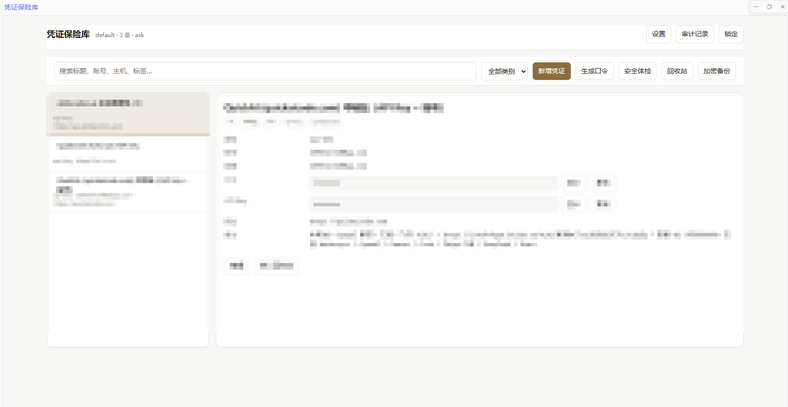

# 凭证保险库 · Hana App

一个加密凭证保险库：以主密码派生密钥、AES-256-GCM 认证加密落盘，保存网站登录、SSH、API Key、OAuth 令牌与 TOTP 密钥；既能被 Agent 在对话里检索调用，也带一个整页图形管理界面。

**完全开源**，MIT 许可。

## 改造来源

本 App 是 **DSH 插件 `dsh-vault` 的 Hana 迁移与改造版**。

- 上游项目：`dsh-vault`（作者 Ox0400，MIT 许可）——加密内核的直接来源。
- 本 App 复用了上游的加密内核（`lib/vault-core.js`），在原样保留 AES-256-GCM + scrypt、库文件格式与条目结构的前提下，把它移植到 Hana 的 v2 App 运行时上，并重写了服务层、工具集与管理界面。
- 因此 **v1 时代的库文件可被本 App 直接读取**，迁移只需复制文件，无需重新加密。
- 上游 MIT 许可与第三方组件声明随包携带（见 `ui/assets/THIRD_PARTY_NOTICES.txt` 与 `LICENSE`）。

## 功能

- **密钥不进对话**：检索只返回摘要（标题 / 账号 / 主机 / 标签），永不返回口令、密钥、令牌。
- **落盘即加密**：磁盘上只有密文，GCM 校验标签能识别错误主密码与篡改。
- **可管理**：整页界面里检索、新增、编辑、删除、回收站、TOTP、生成口令、安全体检、近期审计、加密备份导出。
- **脚本可用**：带 `env` 标签的条目可渲染成 `KEY=VALUE` 交给脚本，明文不必进入模型上下文。

## 界面

> 截图中的条目标题与字段已由作者遮盖处理。

## 安全设计

| 环节 | 做法 |
|---|---|
| 密钥派生 | `scrypt(主密码, 每库随机盐)` → 256 位密钥，参数随密文持久化以便日后升级 |
| 加密 | AES-256-GCM，每条记录独立随机 nonce，杜绝 IV 复用 |
| 校验 | 固定明文的校验信封，错误主密码立即失败，绝不返回乱码 |
| 落盘 | 原子替换 + 跨进程文件锁；文件权限 0600、目录 0700 |
| 检索 | 摘要不含任何密钥字段 |
| 主密码 | **只存在于 App 进程内存**；本 App 不提供任何"保存主密码"的入口，也不自动解锁 |
| 自动锁定 | 闭包空闲超时自动锁定，离开页面尽力锁定 |
| 暴力破解 | 连续解锁失败递增延迟 |
| 写入 | 默认只读；写入需在面板显式授权，彻底删除仍需二次确认 |
| 审计 | 独立无密钥审计日志（unlock / lock / add / update / trash / restore / purge / import），从不记录口令 |

> 与同类实现的差别：许多插件允许把主密码存进配置文件以支持"重启自动解锁"，代价是主密码以明文落在本地磁盘上。本 App 选择不提供这个开关。

## 数据位置

`<HANA_HOME>/app-data/hana-vault/vaults/<库名>.json`（默认库名为 `default`）。

若从 v1 插件迁移，把 `plugin-data/hana-vault/vaults/*.json` 复制到上述目录即可；库文件格式不变。

## 权限说明

| 能力词 | 用途 |
|---|---|
| `app/tools.expose-to-model` | 让模型可以调用本 App 的 21 个工具 |
| `app/ui.clipboard-write` | 界面上的「复制」按钮 |
| `app/resources.write` | 加密备份经宿主另存为文件 |

本 App **不请求任何出站网络能力**（无 `network` 声明），不会联网。

## 工具清单

`vault_status` `vault_unlock` `vault_lock` `vault_list` `vault_search` `vault_get` `vault_add` `vault_update` `vault_delete` `vault_restore` `vault_purge` `vault_totp` `vault_generate_password` `vault_health` `vault_watchtower` `vault_stats` `vault_strength` `vault_config` `vault_export` `vault_import` `vault_audit`

## 许可

MIT（见 `LICENSE`）。加密内核来自 `dsh-vault`（MIT，© Ox0400），其许可与声明一并保留。
